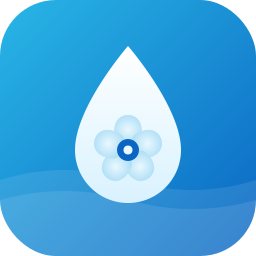

<p align="center">
  
</p>

<h1 align="center">Dontek Aquatek — <i>Unofficial</i> Home Assistant integration</h1>

<p align="center">
  Control your <b>Dontek</b> pool controller from Home Assistant — water temperature,
  pump mode and variable pump speed — over the same cloud the official app uses.
</p>

<p align="center">
  
  <a href="https://github.com/hacs/integration"></a>
  <a href="https://github.com/jbyoll/dontek-aquatek-ha/releases"></a>
  <a href="https://github.com/jbyoll/dontek-aquatek-ha/actions/workflows/validate.yml"></a>
  <a href="LICENSE"></a>
</p>

---

Works with Dontek pool controllers sold under several brands — **Aquatek**, **Oasis Smart**, **Theralux
Pool+ Manager**, **Waterco Pooltek**, **Henden Control** and **Aquamate X** — which are the
same hardware with different labels.

> [!IMPORTANT]
> **This is an unofficial, community-built integration.** It is **not affiliated with,
> authorised by, or endorsed by Dontek Electronics**, and "Dontek", "Aquatek", "Theralux",
> "Pooltek" and related names are trademarks of their respective owners, used here only to
> describe compatibility. It was created by reverse-engineering the app's cloud traffic, uses
> **no official Dontek API**, and may stop working if Dontek change their backend. Use at your
> own risk. Tested against a single variable-speed-pump setup.

## ✨ Features

| | Entity | Details |
|---|---|---|
| 🌡️ | **Water temperature** | `sensor` — pool water temperature in °C |
| ⚙️ | **Pump mode status** | `sensor` — Off / On / Auto |
| 🏃 | **Pump activity** | `sensor` — live state: Running / Priming / Idle … |
| 🔢 | **Running speed** | `sensor` — the speed the pump is *actually* running at (1–4) |
| 🎛️ | **Pump mode** | `select` — set Off / On / Auto |
| 🏊 | **Pump speed** | `select` — set the default speed 1 / 2 / 3 / 4 |
| 📊 | **Speed 1–4 power** | `number` — tune each speed's power % |
| ⏱️ | **Filter 1–4 start / end** | `time` — each schedule window (all four filter times) |
| 🔁 | **Filter 1–4 enabled** | `switch` — turn each schedule on/off |
| 🏊 | **Filter 1–4 speed** | `select` — speed used by each schedule |
| 🔥 | **Heater** | `climate` — Off / Heat, target temperature (0.5 °C steps), heating/idle *(disabled by default; enable it if you have a heater)* |
| ♨️ | **Run til heated** | `switch` (config) — setting: heater switches off once the setpoint is reached instead of staying on *(disabled by default)* |
| 🔌 | **Socket 2–5** | `select` — Off / On / Auto for each socket, named after the socket's name in the app or its appliance type (e.g. *Socket 2 Robot*). Sockets set to *Always On* show On but can't be switched (same as the app); sockets set to *None* are unavailable |
| 🛠️ | **Socket 1–5 type** / **name** | `select` / `text` (config) — change a socket's appliance type and its 16-character name, the same settings as the app's Appliance Setup. ⚠️ Changing a socket's type turns it Off |
| 🟢 | **Socket 1–5 running** | `binary_sensor` — whether each socket is energised right now. Unavailable when no appliance is assigned. For a variable-speed pump this is the relay feeding the pump, so it can read *running* while the pump itself is idle |
| 🛁 | **Pool / Spa mode** | `select` — switch between pool and spa. Enabled by default on an Aquatek with **Spa Enabled** turned on in the app's Spa Setup; otherwise created disabled |
| 🌞 | **Roof temperature** / **Solar pump** | `sensor` / `binary_sensor` — roof sensor and solar pump flag *(Oasis only, disabled by default)* |
| ⛲ | **Water feature** | `switch` — water feature socket on/off (e.g. spa jets / valve) *(disabled by default)* |

> In **Auto** mode the pump follows its filter schedule, so the live **Running speed** can
> differ from the **Pump speed** you set — just like the official app's status screen.

- ☁️ **No extra hardware** — talks to the Dontek cloud, works from anywhere.
- 🪶 **No heavy dependencies** — uses Home Assistant's built-in MQTT library and signs the
  AWS connection itself (no `boto3` / `awscrt`).
- 🔐 **Your account only** — anonymous cloud access, scoped to the controller you configure.

## 📦 Installation

### HACS (recommended)

[](https://my.home-assistant.io/redirect/hacs_repository/?owner=jbyoll&repository=dontek-aquatek-ha&category=integration)

1. **HACS → ⋮ → Custom repositories** → add `jbyoll/dontek-aquatek-ha`, category **Integration**.
2. Install **Dontek Aquatek Pool Controller** and **restart Home Assistant**.
3. **Settings → Devices & Services → Add Integration → Dontek Aquatek**.

### Manual

Copy `custom_components/dontek_aquatek` into your Home Assistant `config/custom_components/`
folder and restart.

## ⚙️ Configuration

Add the integration from the UI and enter the **serial number** printed on the controller
label — the long number under the QR code, e.g. `56559560543361145`. You can also enter the
12-character MAC directly.

<p align="center"></p>

That's it — the device and its entities appear automatically.

## 🧭 How it works

The controller has **no local API**; on your LAN it only serves a Wi-Fi setup page, so all
control goes through Dontek's AWS cloud:

- **Auth** — an anonymous AWS **Cognito** identity pool (guest credentials, no login).
- **Transport** — AWS **IoT MQTT over WebSockets**, SigV4-signed. This integration signs the
  connection itself using Home Assistant's bundled `paho-mqtt`.
- **Protocol** — **Modbus-over-MQTT**: JSON messages
  `{"messageId":"read"|"write","modbusReg":R,"modbusVal":[…]}` on `dontek<mac>/cmd/psw`,
  with the controller replying on `dontek<mac>/status/psw`.

### Register map

| Reading / control | Register | Encoding |
|---|---|---|
| Water temperature | `79` (fallback `57545`) | °C = raw ÷ 2 (fallback: raw ÷ 256) |
| Pump mode (Hayward VSP) | `65485` | `0` = Off · `1025` = On · `65535` = Auto |
| Socket 1–5 mode | `65336`–`65340` | `0` = Off · `1` = On · `2` = Auto (`65336` = Socket 1 / Filter pump) |
| Socket 1–5 appliance type | `65323`–`65327` | index into the app's list: `0` None · `1` Sanitiser · `2` Filter Pump · `3` Cleaning Pump · `4` Blower · `5` Pool Light · `6` Spa Light · `7` Garden Light · `8` Water Feature · `9` Solar · `10` Other · `11` Always On · `12` Jet Pump · `13` Heating Pump (ind.) · `14` UV Sanitiser |
| Socket 1–5 name | 8 registers each from `57344` (Socket n = `57344 + 8 × (n − 1)`) | ASCII, 2 characters per register, max 16. The app writes all 8 in one message, zero padded; empty = all `0` |
| Socket 1–5 running (live) | `160`–`164` | `0` = off · `1` = running · `2` = no appliance assigned |
| Valve 1–4 type | `65328`–`65331` | `0` = None (modes not mapped yet) |
| Pool / Spa mode | `65313` | `0` = Pool · `1` = Spa |
| Spa enabled (Spa Setup) | `65482` | `0` / `1` |
| Pump speed (set/default) | `65463` | `0–3` → Speed 1–4 (display = value + 1) |
| Live run-state word | `92` | high byte = state (`12` = Running) · low byte = running speed (0–3) |
| Speed 1–4 power % | `65478`–`65481` | 0–100 % |
| Filter Time enable mask | `65318` | **bitmask** — bit 0 = FT1 … bit 3 = FT4 (`1` = FT1 only, `15` = all four) |
| Filter Time start / end | FT1 `65319`/`65320` · FT2 `65321`/`65322` · FT3 `65469`/`65470` · FT4 `65471`/`65472` | hour × 256 + minute (08:00 = 2048) |
| Filter Time speed | FT1 `65473` · FT2 `65474` · FT3 `65475` · FT4 `65476` | 0–3 → Speed 1–4 |
| Heater on/off | `65348` | `0` = Off · `1` = On (no Auto in the app) |
| Heater setpoint | `65447` | °C × 2 (`80` = 40.0 °C) |
| Run til heated (setting) | `65500` | `0` / `1` |
| Heater active (calling for heat) | `172` | `0` / `1` (`2` seen on a unit with no heater) |
| Water feature (socket) | `65345` | `0` = Off · `1` = On |
| Run Once (one-shot) | enable `57630` · start `57650` · end `57670` | mapped, not yet exposed as entities |

## 🔧 Troubleshooting

- **"Could not reach the controller"** when adding — double-check the serial number and that
  the controller is powered and online (it shows up in the official app).
- **Entities unavailable** — the integration polls the cloud every 30 s; a transient cloud or
  Wi-Fi drop clears on the next poll.
- Enable debug logging:
  ```yaml
  logger:
    logs:
      custom_components.dontek_aquatek: debug
  ```

## 🔒 Security note

Dontek's guest cloud policy is broad: any client that knows a controller's MAC can read and
write its registers, and the MAC is derived from the serial printed on the label. **Keep your
serial / QR code private.** This integration only communicates with the controller you set up.

## 🗺️ Roadmap

- [x] Map all four filter-time schedules (done in v0.4.0)
- [x] Filter Pump (Socket 1) control (done in v0.5.0)
- [x] Brand icons — shipped in the integration's `brand/` folder, served via Home
  Assistant's local brand proxy (home-assistant/brands no longer accepts custom
  integrations as of HA 2026.3)
- [ ] Map remaining registers (flow, live RPM/power readback)
- [ ] `number` entities for the per-speed RPM setpoints
- [x] Expose Run Once as a one-shot action/button (done in v0.6.0)
- [x] Heater (on/off + setpoint), Run til heated, Water feature (done in v0.7.0)
- [ ] Chlorinator / lighting support on units that have them
- [x] Expansion sockets (Off / On / Auto for sockets 2–5) and Pool / Spa mode on Aquatek
- [ ] Valves, and separate pool / spa heater setpoints

## 🤝 Contributing

Issues and PRs welcome — especially register captures from **other Dontek models**. See
[CONTRIBUTING.md](CONTRIBUTING.md).

## 📄 License

[MIT](LICENSE) © 2026 Jason Brandon · Not affiliated with Dontek Electronics.
